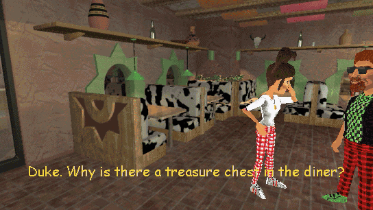
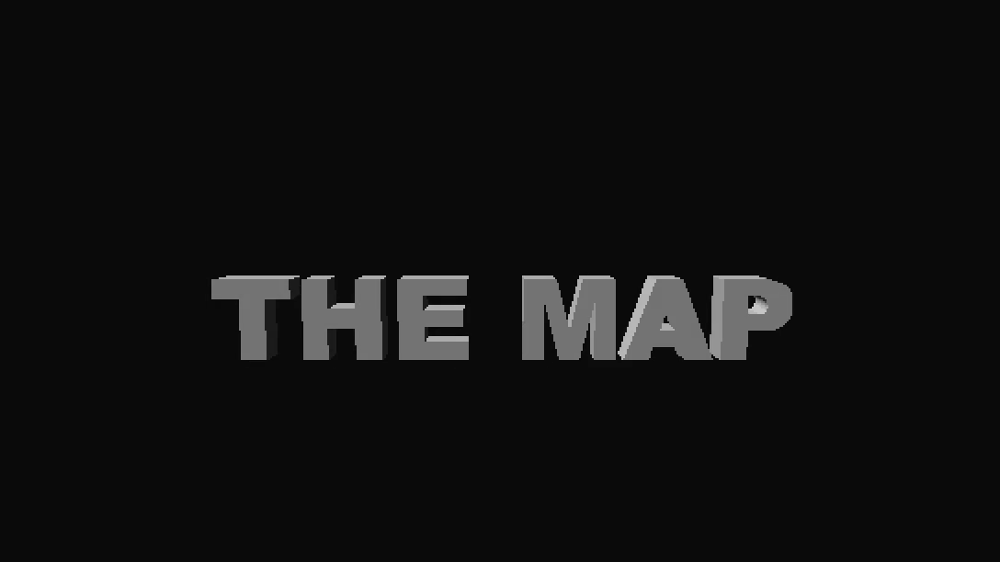
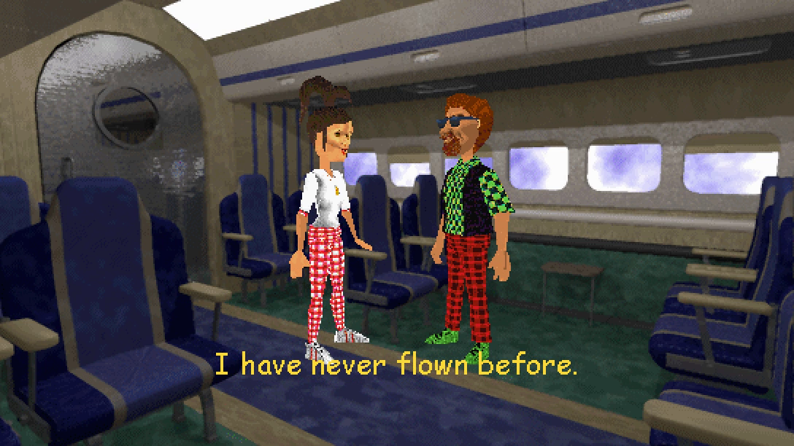
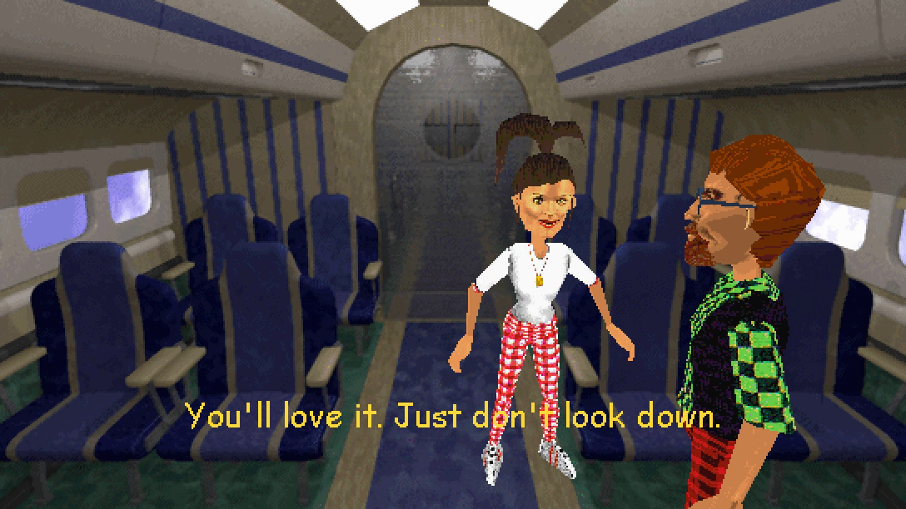
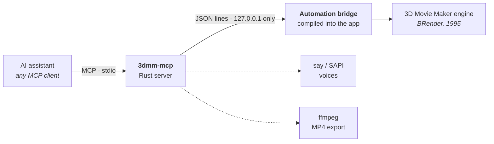

<div align="center">

# 3DMM-AI

**An MCP server that turns Microsoft 3D Movie Maker (1995) into a film studio for your AI assistant.**

Describe a short film, and your assistant casts it, blocks it, voices it, acts it, cuts it and exports the MP4,
inside the real 3D Movie Maker engine, with the 6 fps, Comic Sans charm intact.



<sub><i>“The Map”: one <code>script_movie</code> call, about 15 seconds to build. Every frame above is stock 3D Movie Maker.</i></sub>

<br>


[What it does](#what-it-does) · [Quick start](#quick-start) · [Editing rules](#editing-rules) ·
[Benchmark](#benchmark) · [How it works](#how-it-works) · [Tools](#tools) · [Credits](#credits)

</div>

---

## What it does

You ask your assistant for a movie in plain words: *“make me a 30-second movie of two guys arguing in a diner.”*
It writes a short screenplay and hands it to one of this server's tools. Typically 10 to 30 seconds later there is a
finished `.3mm` movie and an MP4:

<table>
<tr>
<td width="33%" align="center"><br><sub><b>3D title and end cards</b><br>animated 3D words, scaled to fit</sub></td>
<td width="33%" align="center"><br><sub><b>A two-shot…</b><br>blocked so other cameras can see them</sub></td>
<td width="33%" align="center"><br><sub><b>…and its reverse</b><br>over the shoulder, sides kept</sub></td>
</tr>
</table>

- **Voices.** Each character keeps one text-to-speech voice for the whole movie. A `mood` changes both the gesture
  and the delivery: speed, loudness and pitch.
- **Acting.** Talking, laughing, fainting and running use 3D Movie Maker's own animations. Listeners react before a
  line ends, and characters enter, cross, exit and throw things with simple physics.
- **Editing.** Shots are chosen line by line, using the rules listed [below](#editing-rules).
- **Plain .3mm files.** The output is ordinary 3D Movie Maker content. Open it in the Studio and keep editing by
  hand.

## Quick start

**macOS** (Apple Silicon or Intel). You need Xcode command line tools, CMake 3.28+, Ninja, a bootstrapped
[vcpkg](https://vcpkg.io) checkout, Rust and ffmpeg (`brew install ffmpeg`).

```sh
git clone https://github.com/Callamane/3DMM-AI.git && cd 3DMM-AI
export VCPKG_ROOT=~/vcpkg                          # the path must not contain spaces
cmake --preset arm64-macos-relwithdebinfo          # Intel: x86_64-macos-relwithdebinfo
cmake --build build/arm64-macos-relwithdebinfo --target install
cargo build --release --manifest-path tools/3dmm-mcp/Cargo.toml
```

Then register the server with your assistant. For Claude Code:

```sh
claude mcp add --scope user 3dmm -- "$PWD/tools/3dmm-mcp/target/release/3dmm-mcp"
```

Other [MCP](https://modelcontextprotocol.io) clients take the same binary path in their server config. Ask for a
movie, and the server starts 3D Movie Maker on the first tool call: windowed, straight into the Studio.

> [!NOTE]
> **Windows** support is written but untested. The bridge uses Winsock, speech uses Windows' built-in voices, and the
> MCP server builds for `x86_64-pc-windows-msvc`, but nobody has run it on Windows yet. Reports welcome.
> **Linux** builds the app, but the server has no text-to-speech there yet, so scripts with dialogue fail.

<details>
<summary><b>Configuration</b></summary>

| Variable | Default | What it does |
|---|---|---|
| `THREEDMM_APP` | the build in `dist/` | Which app (`.app` bundle or executable) the server starts |
| `THREEDMM_PORT` | `7341` | Bridge port (always `127.0.0.1`) |
| `THREEDMM_NO_AUTOLAUNCH` | unset | `1` means only use an app that is already running |
| `THREEDMM_FFMPEG` | `ffmpeg` on `PATH` | ffmpeg for MP4 export and voice pitch |

</details>

## A whole movie in one call

`script_movie` takes a screenplay and does the rest. This call makes a 27-second, two-scene argument in a diner,
with a spinning title card:

```json
{
  "export": "/Users/me/Movies/argument.mp4",
  "title_card": {"text": "THE ARGUMENT", "action": "Spin Letters", "music": "curious moment"},
  "end_card": "THE END",
  "scenes": [
    {
      "background": "diner", "music": "tense", "subtitles": true, "transition": "dissolve",
      "cast": [{"name": "Lou", "actor": "Billy"}, {"name": "Moe", "actor": "Hiro"}],
      "props": [{"prop": "Treasure chest", "beside": "Moe"}],
      "lines": [
        {"who": "Lou", "says": "You said the game was at eight.", "mood": "angry"},
        {"who": "Moe", "says": "I said nine. I always say nine.", "mood": "happy", "reaction": "Mad, Sad"},
        {"who": "Lou", "does": "Mad", "seconds": 1.5},
        {"who": "Moe", "does": "Laugh", "seconds": 1.5}
      ]
    },
    {
      "background": "diner", "camera": 2, "subtitles": true,
      "cast": [{"name": "Lou", "actor": "Billy"}, {"name": "Moe", "actor": "Hiro"}],
      "lines": [
        {"sound": "bell service"},
        {"who": "Lou", "says": "Fine. Then you're buying the pie."},
        {"who": "Lou", "throws": "Sphere", "at": "Moe", "reaction": "Mad", "hit_sound": "bump"},
        {"who": "Moe", "exits": "left"}
      ]
    }
  ]
}
```

Every scene is checked before anything is built, and errors point at the exact line (`scenes[1]: lines[2]: …`).
The result lists each line's frames, the shot list and anything the automatic review found, with a storyboard image
of the whole movie.

| Line | Does |
|---|---|
| `says` | Spoken with the character's voice and a talking animation; optional `mood`, `to`, `reaction` |
| `does` | Any of the character's animations, for `seconds` (running and sneaking actually travel) |
| `enters` / `exits` | Walk on or off, `left` or `right` |
| `walks_to` | Cross to another character or a spot |
| `throws` | A prop `at` someone, with physics, an optional `reaction` and `hit_sound` |
| `sound` / `wait` | A sound effect by name, or a pause |

## Editing rules

`auto_camera` tries every camera on every line and chooses the cuts with a scoring pass
([`directing.cpp`](src/automation/directing.cpp), [`directcmd.cpp`](src/automation/directcmd.cpp)). These are the
rules it scores by:

| Rule | What it does |
|---|---|
| **Coverage** | Blocking prefers spots where other cameras also see the actors' faces, so there are angles to cut to |
| **Cutting on dialogue** | Cuts are cheap when the speaker changes and cost more otherwise; holding one angle past about 6 s (12 s in the `wide` style) costs more the longer it runs |
| **Clean singles** | A shot of the speaker alone, large and facing the camera, can win over the wide two-shot |
| **The 180° rule** | Cameras across the line between the speaker and their partner are penalised. If one is the only way to see the speaker, it's used and the shot carries a warning |
| **Jump cuts** | Cutting between two cameras that film the same view (some sets only swap the backdrop) is heavily penalised |
| **Screen direction** | Entrances and exits stay on the camera they were staged for, so “exits left” leaves left |
| **Readable faces** | A line spoken by someone under 30% of the frame's height gets a warning |
| **Restaging** | If a scene still has warnings or a long held shot (and the script didn't pin a camera), the set's cameras are ranked and the scene is rebuilt on the best four; the cleanest build is kept |
| **Legible text** | Subtitles are added after the cuts, so their colour is picked against the shot they appear over |

The geometry checks (side of the line, same view, shot pacing) have unit tests in
[`automation_test.cpp`](src/automation/tests/automation_test.cpp). The benchmark below checks the end result.

## Benchmark

[`quality_bench.rs`](tools/3dmm-mcp/tests/quality_bench.rs) scripts the same two scenes, a two-person argument and
a three-person scene with an entrance and an exit, on **all 12 stock sets**. It counts the problems a viewer would
notice:

| | First run | Now |
|---|---:|---:|
| Scenes with no warnings | 23 / 24 | **24 / 24** |
| Scenes holding one angle the whole time | 6 | **3**, all where holding is right ¹ |
| Scenes with jump cuts (cuts that only swap the backdrop) | 2 | **0** |
| Time to build all 24 scenes | 85 s | 2.5 to 3.5 min |

<sub>¹ Listed in the test with reasons: the black set (both scripts), whose cameras only change the backdrop, and the
cave dialogue, where only one camera shows both faces at a readable size. A shot held over 10 s anywhere else fails
the test.</sub>

These are automatic checks. They catch framing and continuity mistakes; they can't tell you whether a scene is funny.

```sh
cargo test --release --manifest-path tools/3dmm-mcp/Cargo.toml --test quality_bench -- --ignored --nocapture
```

## How it works



- **Automation bridge** (`src/automation/`, C++). A small command server inside the app. It calls the movie engine
  directly on the UI thread, listens on `127.0.0.1` only, and is **off unless enabled**. It can be compiled out
  entirely with `-D3DMM_AUTOMATION=OFF`.
- **MCP server** (`tools/3dmm-mcp/`, Rust, [`rmcp`](https://crates.io/crates/rmcp)). It turns the bridge into MCP
  tools, returns rendered frames as images, and adds what an engine from 1995 can't do: scripts, voices, editing
  decisions and video export.
- **The file format is unchanged.** Movies are ordinary `.3mm` files using the stock content, and open in the
  Studio like any other.

Engineering notes on the object model, coordinates, design decisions and the measurements behind the numbers above
are in [doc/automation/NOTES.md](doc/automation/NOTES.md).

<details>
<summary><b>Driving the bridge directly</b></summary>

Start the app with `--automation` (port 7341) or `--automation=PORT`, or set `THREEDMM_AUTOMATION=1` (or a port
number). The app logs `automation: listening on 127.0.0.1:PORT` to stderr. It skips the intro, opens the Studio with
a new movie and runs in a window, about 6 s from launch to ready. One client may connect at a time.

One JSON object per line in each direction:

```
→ {"id": 1, "cmd": "add_actor", "args": {"template": "Billy", "position": {"x": -1, "z": 1}}}
← {"id": 1, "ok": true, "result": {"actor": {"id": 0, "name": "Billy", ...}}}
← {"id": 2, "ok": false, "error": {"code": "not_found", "message": "no actor/prop named 'Bily'; ..."}}
```

`hello` returns the protocol version (currently 1). Error codes: `bad_args`, `not_found`, `bad_state`,
`engine_error`, `unknown_command`, `io_error`. Requests run in order; `play` with `"wait": true` replies when playback
ends. Content can be named by id (`"bkgd:2:2"`) or by name (case-insensitive; unique prefixes work), and actors by
numeric id or name.

</details>

### Tools

| Group | Tools |
|---|---|
| **Make a movie** | `script_movie` (a whole multi-scene movie from one screenplay, with optional 3D title and end cards, checked before anything is built, optionally exported), `script_scene` (one scene: set, cast, props, blocking, dialogue with moods and reactions, subtitles, pacing, actions, entrances, exits, crosses, throws, sound and music, cuts and a review), `batch` (several calls in one) |
| Session | `launch`, `get_state` (`all_scenes` for total length), `goto_studio`, `new_movie`, `open_movie`, `save_movie`, `undo`, `redo`, `checkpoint`, `restore_checkpoint`, `list_checkpoints` |
| Catalog | `list_backgrounds` (with cameras and descriptions), `list_cameras`, `list_templates` (actors described by look), `list_actions`, `list_costumes`, `list_materials`, `list_sounds`, `list_3d_word_styles` |
| Scenes | `add_scene`, `set_background`, `select_scene`, `set_camera`, `set_transition`, `delete_scene`, `move_scene`, `duplicate_scene`, `import_scenes` (from another .3mm), `trim_scene`, `goto_frame`, `add_pause` |
| Actors | `add_actor`, `add_3d_word`, `select_actor`, `remove_actor`, `set_action`, `move_actor` (walk a path, stepping around people), `physics` (drop, throw or launch with gravity, bounces, collisions, spin and squash-and-stretch), `animate` (act on the spot for a duration), `arrange_actors` (block a group facing each other, all in shot, clear of furniture, where other cameras can see them), `place_actor`, `rotate_actor` (`face` another actor, the camera or a point), `scale_actor`, `set_costume`, `set_name`, `actor_lifetime` |
| Text and sound | `add_text`, `edit_text`, `remove_text`, `import_sound`, `attach_sound`, `remove_sound`, `speak_line` (text-to-speech dialogue, attached and acted) |
| Observe and edit | `describe_scene`, `describe_timeline` (who does what, when), `render_frame` (the image; `overlay` draws the stage grid and labels), `preview_cameras` (every angle of a set in one image), `storyboard` (a scene, or the whole movie, in one image), `suggest_camera`, `auto_camera` (edits a scene's cuts by the rules above), `review_movie` (actors out of shot, cut off or hidden, unreadable text, dead stretches, each with a fix), `play`, `stop` |
| Export | `export_video` (MP4 with transitions, voices, effects and MIDI music; `max_megabytes` keeps it under a size), `export_media` (frames plus audio cues), `export_frames` (PNG sequence) |

The server checks every call against the tool's schema and rejects unknown argument names instead of guessing.
Backgrounds and actors also match their descriptions, so `add_scene(background: "diner")` finds the restaurant set.
A workflow guide is published as the resource `3dmm://guide/workflow`, along with a `make_movie` prompt.

### Coordinates

Positions are **stage coordinates in metres, relative to the current camera**. `x` is right (+) or left (−) on
screen, `z` is away from (+) or toward (−) the camera, and optional `y` is height above the floor. The origin is
where 3D Movie Maker drops new actors for that camera. Raw engine coordinates are available as
`{"world": [x, y, z]}` (10 units = 1 m). Time is in frames: 6 per second, numbered per scene from 1.

<details>
<summary><b>Limitations</b></summary>

- One level of undo (an engine limit), and saving clears it. Use `checkpoint` / `restore_checkpoint`.
- No lip sync; the engine has none. Spoken lines pair the voice with a talking animation.
- Recording an action or path replaces what that actor did after that frame, as in the Studio.
- Frames are 8-bit, 544×306, like the Studio's view. That is the look, and it stays at 6 fps on purpose.
- `export_video` follows the engine's own sound rules: a new sound replaces the one on the same actor unless it is
  queued, and sounds stop at the end of their scene.
- Debug builds show assertion dialogs that block automation. Use a release build when running unattended.
- Only one copy of the app can run at a time.

</details>

## Building from source

<details>
<summary><b>Requirements and build steps for Windows, macOS and Linux</b></summary>

### Requirements

* CMake 3.28+ and Ninja
* Windows: Visual Studio 2022 with the *Desktop development with C++* workload (Clang optional)
* Linux: GCC; development libraries for SDL2, SDL2_ttf, gstreamer, GTK3, iconv and Fontconfig; Zenity (optional);
  the [Comic Sans MS font](https://corefonts.sourceforge.net/) (strongly recommended)
  * Ubuntu: `sudo apt install g++ cmake ninja-build libsdl2-dev libsdl2-ttf-dev libgstreamer1.0-dev libgstreamer-plugins-base1.0-dev libgtk-3-dev libfontconfig-dev zenity`
* macOS: Xcode tools and vcpkg (it builds SDL2, Fontconfig, FluidSynth and their dependencies; some need
  `brew install autoconf autoconf-archive automake libtool`)
* The MCP server: a Rust toolchain

### Windows

* Open the Developer Command Prompt for Visual Studio 2022
* `cmake --preset x86-msvc-debug` (or `x86-msvc-relwithdebinfo`; there are x64 and Clang presets too)
* `cmake --build build\<preset> --target install` (creates `dist\<preset>` with the layout 3DMM needs)
* Tests: `ctest --test-dir build\<preset>`. Package: `cmake --build build\<preset> --target dist`

### macOS

* Set `VCPKG_ROOT` to your vcpkg checkout
* `cmake --preset arm64-macos-relwithdebinfo` (Intel: `x86_64-macos-relwithdebinfo`; `-debug` presets too)
* `cmake --build build/<preset> --target install`, then run `dist/<preset>/3D Movie Maker.app` (macOS 12+)

### Linux and other platforms

* `cmake --preset sdl-relwithdebinfo` (or `sdl-debug` for development)
* `cmake --build build/<preset> --target install`, then run `dist/<preset>/3dmovie`

Settings live in `3dmovie.ini`: `%APPDATA%\3DMMEx\` on Windows, `~/Library/Application Support/3DMMEx/` on macOS,
`~/.config/3DMMEx/` on Linux. In-app help is in the Studio's Help Machine and the Projects Room tutorials.

</details>

## Credits

3DMM-AI stands on a long line of people who kept 3D Movie Maker alive:

- **[Microsoft 3D Movie Maker](https://github.com/microsoft/Microsoft-3D-Movie-Maker)**: the original 1995 source,
  released under MIT in 2022
- **[3DMMForever](https://github.com/foone/3DMMForever)** by foone: the community project that got it building again
- **[3DMMEx](https://github.com/benstone/3DMMEx)** by benstone: the cross-platform source port this is built on,
  with SDL2, 64-bit, macOS and Linux support

3DMM-AI adds the automation bridge, the MCP server, the scripting, voices and editing. It is an independent project,
not affiliated with or endorsed by Microsoft or the projects above.

## License

MIT, as in the original release. See [LICENSE](LICENSE).

<details>
<summary><b>Legal notes carried over from the original release</b></summary>

### Code cleanup

This code was restored from the Microsoft corporate archives and cleared for release.

* Developer names and aliases were removed, with the exception of current employees who worked on the
  original release who consented to keeping their names in place
* The archive consisted of several CDs, some of which were for alternate builds or products, and
  have been excluded
* The code does not build with today's engineering tools, and is released as-is.

### Trademarks

This project may contain trademarks or logos for projects, products, or services. Authorized use of Microsoft
trademarks or logos is subject to and must follow
[Microsoft's Trademark & Brand Guidelines](https://www.microsoft.com/en-us/legal/intellectualproperty/trademarks/usage/general).
Use of Microsoft trademarks or logos in modified versions of this project must not cause confusion or imply Microsoft sponsorship.
Any use of third-party trademarks or logos are subject to those third-party's policies.

This repo includes a build from 1995 of BRender from Argonaut software. Approval to open source BRender as MIT was given in an email from Jez San, former CEO of Argonaut. Other versions of BRender exist at <https://github.com/foone/BRender-v1.3.2> and <https://github.com/foone/BRender-1997> Thanks to Jez and the whole BRender team for their hard work on this amazing engine. A full historical list of BRender contributors is available at <https://github.com/foone/BRender-v1.3.2/blob/main/README.md>

This repo does NOT include the SoftImage SDK "./DKIT" from 1992.

Jez also offered this interesting BRender anecdote in an email:

```
When Sam Littlewood designed BRender, he didn’t write the code. And then document it.
The way most things were built at the time.
First, he wrote the manual.  The full documentation
That served as the spec.  Then the coding started.
```

</details>
